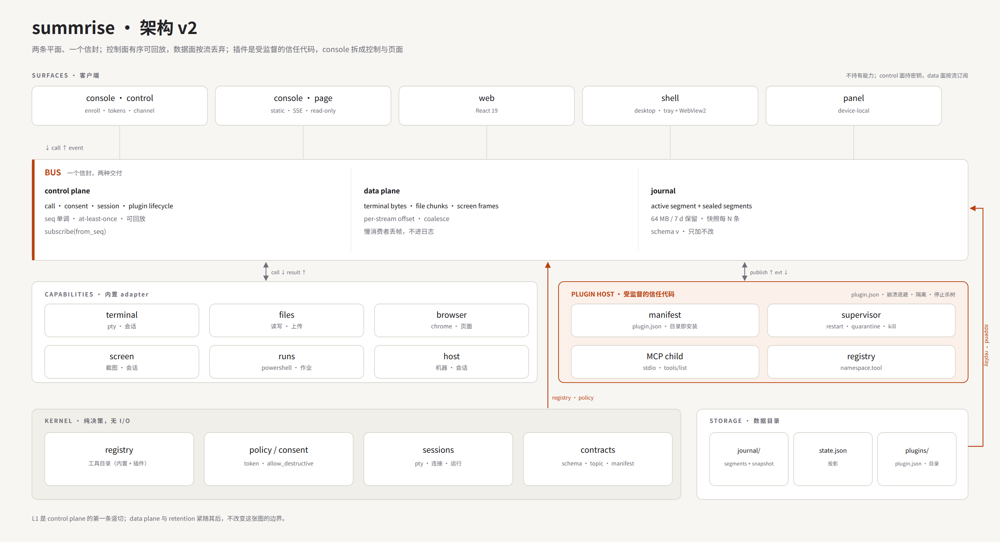
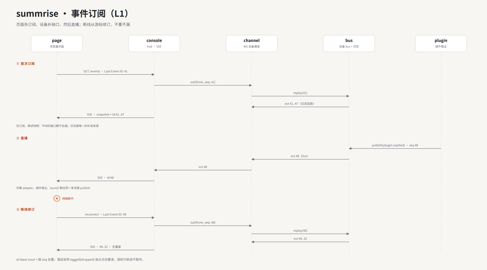

# Architecture of Record: the two-plane kernel

> **Status: architecture of record, 2026-11-12. Approved by the operator: plugins are trusted (no
> signature or sandbox); the desktop surface is the shell, not Electron. Implemented as slices on
> `hub/v1`: the bus and its bounded journal, the `plugin-host` and `console-page` crates, the
> dependency gate, and the shell's panel fallback. `docs/design/program-ledger.md` is the record of
> what is green and what remains — chiefly the Windows packaging rehearsal.**
> This is the architecture `summrise-product` implements from here on. It is argued from
> `docs/PRODUCT.md` (what the product is) and `docs/design/capability-hub-2026-11-02.md` (the plan of
> record); it replaces neither. The first slice that proves it is §8.

Perfect is not a property a design can have before it runs. What this document claims is narrower and
checkable: **every failure mode we know has a named boundary, a stated guarantee, and a test.**



## 0. Six decisions, everything else is a consequence

1. **Two planes, one envelope.** Calls, grants, sessions and plugin lifecycle are the *control plane*:
   totally ordered per device, durable, replayable. Terminal bytes, file chunks and screen frames are
   the *data plane*: per-stream offsets, coalesced, lossy, never journaled. One envelope, two delivery
   classes — so "one bus" stops being a lie the first time a PTY floods it.
2. **The journal is bounded.** It is the device's event log: sealed segments, a periodic snapshot, and
   a retention cap. "Append-only" does not mean "grows forever" on a machine whose constraint is disk.
3. **Plugins are trusted code, supervised.** Installing a plugin is trusting it: it runs on the
   operator's own machine, as the operator. There is no signature, no sandbox and no capability prompt
   in v1. The host still supervises the process — start, restart with backoff, mark it failed after a
   crash loop, kill the tree on stop — because a crash loop is an availability problem, and the install
   screen says once, plainly, that the code runs with the operator's privileges.
4. **The console splits into control and page.** Control holds the keys, enrollment, the device
   channel and the audit store. Page serves the static page, SSE and read-only JSON and holds no keys.
   A page restart cannot mint a token; a console restart cannot corrupt a call record. The split is a
   code boundary first: one binary may host both roles, and the page still never holds a key.
5. **The operator sees everything; a client token sees its tools.** There is one person and one
   operator session, and the event stream is not filtered for them. A token minted for an AI client
   carries tool scopes and does not subscribe, so the model is one rule instead of a topic-scope
   language.
6. **Dependencies are enforced, not drawn.** A CI gate reads `cargo metadata` and fails on an upward
   edge. A poster that says "only downward" and a tree that does it are different things.

## 1. Scope and non-goals

One product, one repo, one runtime per machine, one operator, a handful of machines. Windows is the
target; Linux runs the device in CI and on servers.

The legacy repository (`/home/zss/summrise`, the Agent line) is a separate product. This document does
not merge the two histories; a module moves from it only with a product decision, and the one candidate
(the Electron client) is decided in §9. "One repo" is the target for this product, not a statement that
the other one is gone.

Non-goals for v1: multi-tenant SaaS; device-to-device federation; event sourcing as the system of
record (§9); a second UI.

**Priority order: convenience, then operability, then security.** One person uses this on their own
machines. A gate that costs a click is a bug unless it prevents a failure that person cannot see; a
boundary that stops only a hypothetical attacker is not worth a prompt. Security is accepted where it
is free at the point of use — the record, the stop button, the disk bound — and revisited the day the
product is shared or exposed. An earlier draft of this document proposed a signed plugin manifest and an
OS sandbox; that section is withdrawn (§9).

## 2. Invariants

| # | Invariant | Enforced by |
|---|---|---|
| I1 | One writer for the device journal, a monotonic `seq` per device | `bus` owns the journal; `launch` keeps its own supervisor log, which the bus ingests at boot (S1) |
| I2 | One envelope, two delivery classes | `plane` is a field on the envelope; the writer rejects a class it cannot deliver |
| I3 | The kernel has no I/O | dependency gate; `core` names no runtime crate and imports no `std::fs` |
| I4 | The journal is bounded; state is derived and rebuildable | retention job; `state.json` can be rebuilt from journal + snapshot on recovery |
| I5 | The operator sees everything; a client token sees its tools | one operator session; tokens are tool scopes, not topic scopes |
| I6 | A plugin is trusted; its process is supervised | restart with backoff, mark failed, kill on close — availability, not isolation |
| I7 | The page holds no keys | crate boundary (`summrise-console-page`, no workspace dependency) + a source guard test |
| I8 | Dependencies point one way | `scripts/check-architecture.mjs` reads `cargo metadata --no-deps` and runs in CI before the build: 14 packages, 22 edges, 0 upward |
| I9 | Failure domains restart independently | process domains: device, launch, console, plugin children; the page may be a module and restarts with the console |
| I10 | One UI, one auth path | desktop is a surface of the console, never a second device auth |
| I11 | A destructive call runs only for the owner on loopback, or under a token that carries destructive consent; otherwise it is refused with a reason | `allow_destructive` on the token; a refusal row naming the fix |

## 3. Code shape

```
device/
  core/           kernel: registry, policy, sessions, contracts — no I/O
  bus/            NEW  journal, dispatch, subscriptions, replay — the only writer
  device/         app: adapters (terminal, files, browser, screen, runs, host), channel, MCP
  plugin-host/    NEW  supervision, MCP children (extracted from device/src/plugins)
  console/        control: enroll, tokens, device channel, audit store, subscription hub
  console-page/   NEW  static page, SSE, read-only JSON — no keys
  console/web/    React page
  shell/          tray + WebView2 (Windows)
  launch/         supervisor, updater, the only writer of the app binary
  mesh/           QUIC, rendezvous, relay
  release/        signed release documents, channels, revocation
  ui/             design tokens, shared page shell
  winsec/ winsys/ the OS boundary
```

The device's own panel is not a crate: `device/device/src/panel.rs` renders it in Rust and the device
serves it at `/panel` — the surface that works when the console does not.

The dependency rule: `core ← bus ← {device, plugin-host, console, console-page} ← surfaces`.
`core` imports no crate above it; `bus` imports only `core`; no surface imports another surface;
`device` and `console` import `bus` and `core`, never each other.

## 4. Contracts

### 4.1 Envelope

```json
{"v":1,"plane":"control","seq":123,"ts":"2026-11-12T14:00:00Z","type":"plugin.crashed",
 "subject":{"device":"9VH","plugin":"hello"},
 "trace":{"call":"01J..."},
 "payload":{"reason":"exit 1","restarts":4}}
```

`plane` is `control` or `data`; a data-plane envelope carries `stream` and `offset` where a control one
carries `seq`. `seq` is the control plane's order; `ts` is informational and never orders anything. `v` is the major
schema; within a major changes are additive only, and the bus refuses an unknown major rather than
guessing. `type` is the topic. v1 topics: `call.started|finished|denied`, `session.opened|closed`,
`plugin.installed|starting|ready|stopped|failed|tools_changed`,
`device.started|joined|left|updated`, `grant.minted|revoked`, `stream.gap`, `update.staged|failed`.
Plugin topics: `plugin.installed|starting|ready|stopped|failed|tools_changed`.

### 4.2 Control plane

Totally ordered per device; durable before it is published; at-least-once; replayable from any
`seq` still inside retention. A call is exactly two events (`started`, `finished|denied`) sharing one
`trace.call`, so a reader can always pair them.

**Two journals, two scopes.** The device journal records what ran on the machine. The console audit
records what the operator did: token mints, subscriptions and proxied calls. A proxied call appears in
both, joined by `trace.call`; neither log is rebuilt from the other, and a reader that needs the pair
joins them. The two windows differ — 64 MiB on the device, 8 MiB with two generations on the console
(`device/console/src/audit.rs:54`) — so Activity must say which rows are still replayable and which are
archived.

**Shipped (2026-11-13): the call pair and the join.** The device publishes `call.started` and then
`call.finished` or `call.denied` for every call, whichever door it came through — the console's
channel, the mesh, the device's own panel, loopback — carrying `trace.call` and `subject`
(`{"token"}` or `{"door"}`). The console mints that trace per proxied exchange, sends it in the frame
(`{"id","mcp","trace",...}`), and writes it on its audit line, so the two records join on one value
instead of on two clocks. The console relays a device `call.*` event to the page only when the trace
is not one it minted itself: its own call is already a row from the audit, and a panel, mesh or
loopback call reaches Activity only through this path. The gap the paragraph above described is
closed; what remains is the page drawing the join (the archived/replayable marking).

**Shipped (2026-11-13): the join drawn.** The join key existed on both records and nothing read it, so
Activity could not say which of the rows it drew the machine could still prove. The device now offers
`journal.get` (`journal` capability): for a bounded list of traces it answers which ones its retained
journal still holds, the ones it does not, and its retained bounds (`oldest_seq`/`last_seq`), with
`bounded: true` when its scan stopped at its cap so a negative from a bounded scan is never read as
absence. The console serves `GET /audit/join?device=&traces=`, which asks that tool over the device's
own channel under the operator's scope, mints a trace so the read stays out of Activity, and writes no
audit line of its own — a read that audited itself would grow the window it describes. The page asks
once per machine window (at most 128 traces, debounced, re-asked after 30 s because a journal rotates)
and marks **only the deviation**: a call the machine's journal no longer holds wears `only here`, a call
both records hold wears nothing and has the agreement stated in its opened record, and a call the
console could not check — a fleet window, an older machine without the tool, a failed read, a bounded
scan — is `unknown` and is never marked as lost. The rule the route and the mark both keep is that the
machine's answer is asked, not inferred: a rotated journal is not contiguous with a rotated audit file,
so an interval would be a guess and a missing answer is not evidence.

**Shipped (2026-11-13): the machine's record becomes readable.** Activity could draw what the console
proxied; a call that never reached it — the panel's, a mesh peer's, a direct loopback client's — was
drawn from the live relay and lost on reload. The device now offers `journal.read` (the `journal`
capability): newest first, at most 200 rows, each a summary built from fields the machine already has
(`seq`, `ts`, `type`, `trace.call`, and on a call `tool`, `ok`, `reason`, the `door` it arrived by),
plus `payload_bytes` and `more`; never a payload, because a read that relayed one would be an export
wearing a read's name. The console serves `GET /journal/read?device=&before=&limit=`, asks that tool
down the machine's own channel under the operator's scope, mints a trace so the console's relay drops
the `call.*` pair the read writes, and writes no audit line of its own. The page reads one window per
machine and draws the calls that arrived by a door the console does not own — `panel`, `mesh`,
`loopback`: those are the calls the console never proxied, and a `console` row is the console's own
record's to keep (an audit line, or one of the console's own reads of the machine, which is page
bookkeeping rather than the operator's work). A machine row is merged against the console's window
and dropped when the console already holds the same call, matched by `trace.call` — the console's row
is the richer record — and the journal's own `door` is drawn where a console row shows `console`. The
footer states that the machine's journal was not read when the answer is `unknown` or the read failed;
it stays silent when the machine's record added nothing. **An empty window is never drawn as "the machine
recorded nothing"**: a machine with no journal answers `journal: false` with no rows, and an older
machine, a refusal or an unreadable answer is `unknown` with a reason — a fact about the read, not
about the record.

What remains is replay of what was recorded: a `journal.read` row is a summary and its payload is not
reachable, so paging an archived call's arguments would need a second, bounded verb.

**Shipped (2026-11-13): the audit line learns the machine's `seq`.** The trace joined the two records,
but the console's line could not say *where* in the machine's journal its half sat, so a call whose
machine copy rotated could be marked `only here` and not read back. The device now puts the outcome
half's `seq` on the channel frame (`journal_seq`, beside the JSON-RPC body, never inside it — a
client's tool result grows no Summrise field) when this process keeps a journal and the exchange
reached its outcome. The console writes it on the audit line and the live event as `machine_seq`. The
page opens a proxied row by reading exactly that row back — `journal.read` with
`before_seq = seq + 1, limit = 1` — and draws the machine's own facts (the row's own `ts`, its kind,
the tool and outcome, the door, the payload's size) beside the console's. The row is accepted only
when its sequence **and** its `trace.call` agree with the line: the bus has no per-journal epoch yet
(it is target design), so a reset could make an old sequence name another call. A row the journal has
rotated — or a position that now names a different call — is stated as gone, never as a call that did
not happen; a read that cannot be made says why; an older device names no position, and the record
keeps the console's facts alone.

**Shipped (2026-11-13): the machine's window pages.** The newest 200 journal rows are minutes on a
busy machine, so a device-only call older than that page was unreachable from Activity even though
the journal still held it — the page used neither `journal.read`'s `before_seq` nor its `more`. The
page now keeps a fetch session: the newest page on the machine scope, `before_seq = oldest fetched`
for each older page, and, once the operator has asked, a last page's `more: false` is stated as "The
machine's journal has no rows older than this." A 30 s refresh re-reads the newest page and merges it
in front of the pages already asked for by `seq`, so new calls appear without dropping history; pages
are deduplicated by sequence. A failed older page keeps the rows already drawn and turns the control
into a retry with its reason — a failed page is not a lost window; the same holds when a later refresh
answers `unknown` or "no journal", which does not retract a window that was read, only a window that
never existed. A fetch session does not outlive the window it was read for: a scope change (the fleet,
another machine) drops the pages asked for, so re-entering starts from the newest page again, while
the 30 s newest-page cache stays (it is what makes a remount free). The drawn list, not the console's
1 000-line cut, is the window paging deepens: those older machine rows were already drawn as older
days, and clamping to the console's cut would remove the calls the machine window exists for.

**Shipped (2026-11-13): the counts name the calls the console cannot see.** A client that calls the
machine's own endpoint — the journal's `loopback` door — is a client call the console's audit never
holds, so `/audit/day` cannot count it; the Activity header's `Today` is that day read, the same rule
the hub serves, and inflating it with a page of the machine's window would both break that parity and
state a day total the page cannot know. The page therefore names those calls beside the count:
"N calls drawn today came straight to this machine, not through this console (M failed, when M is
not zero)." It is counted from the same contribution the timeline draws, within the day's start (the
console's `day_start_ms` when the answer names one, otherwise the page's own midnight — the boundary
its labels already use) and never past the next midnight, so the header and the rows can be read
together; `panel` (the desktop), `mesh` (a peer device) and `console` (this
proxy) are not client calls, and a failed direct call is named rather than folded into the day's
failure count. A true day count of a machine's direct calls needs a time-bounded read of its journal,
which `journal.read` does not offer yet — the next item.

**Shipped (2026-11-13): the machine's day can be counted.** `journal.day` answers a day as one
aggregate: two instants the caller owns (the device keeps no timezone), the five doors' call and
failure counts for the outcome rows inside the range, the retained bounds, and `more` when the scan
was cut at 20 000 rows. A call's door is written on its `call.started` half; an outcome whose half is
just below the range is resolved by a bounded lookback (2 000 rows), and an outcome whose half is not
found counts as `unknown` — never as a client's. `GET /journal/day?device=&from=&to=` relays it (no
audit line, no live event), and the page asks for the block its labels index: the console's cut plus
24 hours, or its own midnights. The day sentence then adds the machine's `loopback` calls and
failures to its client number and names the share — "2 straight to this machine (1 failed)" — with
"at least" when the machine's scan was cut; a failed or `unknown` day read keeps the console's number
and says the direct calls were not counted. The hub's fleet number is unchanged: a fleet asks no
machine's journal.

**Shipped (2026-11-13): the fleet's record is asked for, bounded.** A fleet window spans machines, so
no single journal answers for it: it drew only the console's rows and counted only the console's
audit. The page now fans out to the online machines the fleet names — at most `FLEET_MACHINES = 8`,
in the fleet's order, one `journal.read` of the newest page and one `journal.day` of the block the
header counts each, cached 30 s — and merges what they say. A machine's `panel`/`mesh`/`loopback`
calls join the console's rows; the console's row wins a call by `trace.call`, and the untraced
fallback names the machine, because two journals can write the same instant, tool and outcome (the
page's row key is the machine plus the journal's own position for the same reason). The machines'
`loopback` counts are added to the day sentence as "N straight to the machines", with "at least" when
a scan was cut **or** a machine was not counted — including one whose read is still in flight, so a
partial sum never looks precise. What was not read is named rather than folded into a zero: the
footer lists the machines whose journal was not read and why (did not answer, does not offer it,
offline) and the machines the cap left out; the header's note names the machines whose **day** is
missing — up to three, then a count — because a machine whose rows were read but whose day failed is
absent from the footer and must still be findable; both are silent while a read is in flight, since
counting is not the same as not counted. A journal-less machine is complete, not missing: either
answer's `journal: false` says its calls are all in the console's audit. **A refresh keeps the answer
it had**: the hook holds the last page and day while a new read is out and keeps them when that read
fails, so a 30 s cycle neither blinks the rows nor turns an answered machine into an unread one. Four
limits are stated with the feature: the fan-out costs 16 device calls per 30 s at the cap while
Activity shows the fleet window (Home and the Device picker ask nothing; each call is a console-door
call the page never draws, two journal events, about 3 MB a day per asked machine at the retention the
journal keeps); the fleet's day therefore sums at most 8 machines and says when it is a floor; a
window the page left is forgotten after ten cache windows, so a long-lived tab does not grow without
bound; and the join marks remain a machine window's fact — a fleet window asks no single journal for
them, so a fleet row is still never marked `only here`. **"Clients only" now counts a `loopback` door
as a client call**: a machine row has no caller and no token, and the door is its only proof, while
`panel` (the desktop) and `mesh` (a peer) are not the AI's clients. The shared audit table
(`docs/superpowers/specs/audit-buckets.json`) is unchanged: its lines have no door, and the console's
`is_client_call` never sees a machine row.

### 4.3 Data plane

A stream has an id (`terminal:<device>/<session>`, `file:<id>`, `screen:<id>`) and a byte offset.
Frames coalesce for 16 ms; a slow consumer drops oldest and receives `{"stream_gap":{"from":n,"to":m}}`.
Data-plane frames are never journaled and never counted by the audit; the terminal's end is a control
event, its bytes are not.

### 4.4 Journal

`journal/000001.seg` seals at 4 MiB; `journal/snapshot-<seq>.json` is written every 1 000 events or
5 minutes; retention is 64 MiB or 7 days, whichever comes first (`--journal-max-bytes`,
`--journal-retain`). The cap is not new: today's `events.jsonl` is already capped at 64 MiB and rotated to
`events.1.jsonl`, one generation kept, older lines discarded by design (`device/device/src/mcp.rs:89`).
The target keeps 64 MiB as the whole journal — today's 64 MiB is per file, one rotation — and adds
segments plus the time bound.

Writes batch for 16 ms: assign `seq` → append → fsync → publish. A crash may lose the un-fsynced batch,
which was never published; on boot the next `seq` is the journal's last durable one plus one, so a
published `seq` never repeats. Framing is length-prefixed with a CRC; a torn tail is truncated to the
last valid frame at boot. The journal carries an `epoch` (16 random bytes written when it is created): a
new journal — a rollback, a data-directory reset — starts a new epoch, and every cursor is `(epoch, seq)`.

`replay(from)`: inside the window, replay from `from`; past it, `reset{snapshot_seq, lost:{from,to}}`.
The snapshot is always at or before the deletion boundary, so the lost range is named rather than
silently skipped.

`journal.read(before_seq, limit)` is the record itself, summarised: newest first, at most 200 rows per
call, each row carrying its `seq`, `ts`, `type`, the `trace.call` it belongs to, and — on a call — its
`tool`, `ok`, `reason` and the `door` it arrived by. It never returns a payload; `payload_bytes` says how
much the row's payload held, so a page can tell "nothing more was recorded" from "more was recorded and
this is a summary". `before_seq` pages: the answer holds only rows strictly older than it. `more` says
whether a retained row older than the last returned one exists. This is what makes a call the console
never proxied — the panel's, a mesh peer's, a direct
loopback client's — reachable after a reload instead of only through the live relay.

`journal.day(day_start_ms, day_end_ms)` is the same record counted, not listed: the outcome rows whose
moment falls in `[day_start_ms, day_end_ms)` are counted by the door they arrived by (`console`,
`panel`, `mesh`, `loopback`, `unknown`), each with its failures (`ok != true`). The range must be
ordered and no longer than 26 hours; the count stops at `MAX_DAY_ROWS = 20 000` and reports `more: true`
so a caller's number is a floor, never a quiet undercount. A door is on the call's `call.started` half:
the day's own started halves resolve it, and a call that started before the range is resolved by a
bounded lookback below the oldest row (2 000 rows); an outcome whose half is not found is `unknown`.
No rows and no payloads — a page that needs rows has `journal.read`.

`journal.get` answers the join the other way round: given the traces a page is drawing, it scans the
retained rows newest first (`Bus::scan_newest`) and says which of them are still there, plus
`oldest_seq`/`last_seq`. It is presence-only — no payload, no replay — and its scan stops at
`SCAN_ROWS = 10 000`, which it reports as `bounded: true`; a trace absent from a bounded scan is not
proof of absence, so the console relays that as `unknown` rather than as a lost call. A journal append that fails refuses the mutating call (`begin`); a failed `end` is
reported as a lost row and the call still returns — the existing audit policy (`mcp.rs:3196-3199`).

### 4.5 Subscription



```
{"id":7,"sub":{"from_seq":41}}
{"id":7,"ack":{"from_seq":41}}
{"sub":7,"evt":{"seq":48,...}}
{"id":9,"unsubscribe":{"sub":7}}
{"sub":7,"lagged":{"dropped":12,"from_seq":60}}
{"sub":7,"reset":{"snapshot_seq":1000,"lost":{"from":41,"to":999}}}
{"sub":7,"revoked":{"reason":"session revoked"}}
```

One channel per device; N subscribers per channel; each subscriber has a bounded queue (1 024
control events). A subscriber whose oldest queued event is more than 256 behind the head is lagging: it
is told `lagged{dropped, from_seq}`, then either resets from the journal or is disconnected — never
silently skipped. Only an operator session subscribes; a client token calls tools and cannot. A
subscription is an audit row, and a revoked session closes it with a sentence.

The page's SSE carries `id: <epoch>:<seq>` on every event. The console numbers its own rows into the
same sequence (a console-local counter plus its boot epoch), so one `Last-Event-ID` resumes both
sources; a console restart bumps the epoch and the page resets to a snapshot.

### 4.6 Plugin

```json
{"id":"com.example.hello","namespace":"hello","name":"Hello","version":"1.0.0",
 "description":"…","command":["hello.ps1"],"cwd":".","env":{},"transport":"stdio"}
```

The manifest is the one the code reads today (`device/core/src/plugins.rs:37-51`): `id`, `namespace`,
`name`, `version`, `description`, `command`, `cwd`, `env`, `transport`, with `deny_unknown_fields`. The
target adds nothing to it. Installing registers the directory and copies nothing
(`device/device/src/plugins/host.rs:4-6`); the tools arrive from `tools/list` and are advertised as
`<namespace>.<tool>`.

**Trust is stated, not enforced.** Installing runs the code with the operator's privileges;
`PRODUCT.md` already says so and the install screen says it once. There is no signature, no copy to
sign and no sandbox. The one boundary that stays is the process itself, because it keeps a crash from
taking the device down.

**Supervision is about availability.** `installed → starting → ready → stopped → failed`: a child that
exits is restarted with 1/2/4/8/16/30 s backoff; five starts in 300 s mark it `failed` and its tools are
unregistered; the whole child tree is killed when the device stops. Re-enabling is explicit. A memory cap
is optional; fs and network are the operator's own. Every transition is a control event
(`plugin.starting`, `plugin.ready`, `plugin.stopped`, `plugin.failed`, `plugin.tools_changed`), so the
record shows what happened.

### 4.7 Tokens and consent

A token carries `tools:<glob>`, `device:<id>` and `allow_destructive` — what an AI client may call, not
which events it may see. There are no topic scopes: the operator session sees every event, and a client
token does not subscribe at all.

The token is the consent, as `PRODUCT.md:47-49` says. `allow_destructive` is a field on the token
(`device/console/src/tokens.rs:107-108`), and the console mints the grant's `auto_for_destructive` from
it. A destructive call under a grant without it goes to `Ask` (`device/core/src/auth.rs:221-276`) and is
refused with `approval_required` (`device/device/src/mcp.rs:702-720`) — the sentence already says to mint
a grant with `allow_destructive=true`. The owner on loopback is allowed outright (auth rule 1). The
refusal is a row.

**Convenience first: a token minted from the console defaults to `allow_destructive: true`.** The
console shows it as a toggle, already on; turning it off is one click. The operator's console session is
not a token — it is the owner, and rule 1 allows it outright. A client token defaults to off and
can be narrowed to a tool list. There is no pending-approval state in v1: the panel's per-command gate is
the legacy product's mechanism and stays there, because carrying it here would add a queue this product
does not have and would contradict `PRODUCT.md:48-49`. If it is ever wanted, it is a product change that
starts in `PRODUCT.md`.

## 5. Failure modes

| Failure | What happens | Guarantee |
|---|---|---|
| device dies | `launch` restarts it; the channel reconnects | a published event is durable; the ≤16 ms un-fsynced batch was never published; `seq` never repeats |
| console dies | devices keep serving; the page is down; the shell opens the panel | on restart the page resumes from its `Last-Event-ID` |
| journal full | seal, delete oldest sealed segment | older subscribers get `reset{snapshot_seq, lost}`; the snapshot is at or before the boundary |
| plugin crash loop | backoff 1/2/4/8/16/30 s; five starts in 300 s mark it `failed` | tools unregistered; `plugin.failed` is one event |
| slow subscriber | control: `lagged` → reset/disconnect; data: drop + `stream.gap` | no silent loss |
| destructive call, no consent | refused with `approval_required`; the row names the token to mint | never silently run |
| schema skew | publisher or subscriber on an unknown major is refused | no best-effort decoding |
| clock skew | `seq` orders; `ts` is display only | ordering never depends on time |
| journal append fails | a failed `begin` refuses the call; a failed `end` is a lost row and the call returns | a completed side effect is never retried by the client |
| torn tail | truncate to the last valid frame at boot | no half event is replayed |
| fleet cursor | the cursor is `(epoch, seq)`; a new journal starts a new epoch | two devices — and two journals — never share a cursor |
| rollback | an older build refuses a newer journal major and starts a new journal with a new epoch | no silent decode after a downgrade |

## 6. Current state against the target

| Target | Today |
|---|---|
| `core` | `device/core` — registry, grants, sessions, state; the pure half, no workspace dependency |
| `bus` | `device/bus` — one writer, one sequence; `%06d.seg` at 4 MiB, 64 MiB retention, fsync per publish, a snapshot every 1 000 events; `oldest_seq` and `reset{snapshot_seq, lost}`; 12 tests |
| `plugin-host` | `device/plugin-host` — its own crate (core + bus only); supervised; publishes `plugin.starting/.ready/.stopped/.failed/.tools_changed` on the bus |
| `console` + `console-page` | `summrise-console` (control: keys, channel, proxy, audit) and `summrise-console-page` (the page role; no workspace dependency, `PageSource`); one binary hosts both |
| journal | `journal/%06d.seg` beside `events.jsonl`; a cursor that falls off gets `reset{snapshot_seq, lost}` and the retained rows; `device.started`, `session.opened` and `session.closed`, and the plugin lifecycle are rows |
| subscription | channel `{"events":{"from_seq"}}` with `evt`/`reset` frames; the console subscribes from `last + 1` (live-only on a first connect) and relays `device` and `reset` SSE events; every SSE event carries an `id:`, and `Last-Event-ID` replays the page's buffer |
| Activity | the console audit plus device events through the channel; a reset shows as a gap and triggers a reread; the Device page shows the machine's own journal strip |
| desktop | `device/shell`: tray + WebView2; resolves the console from env/`console.json`/build default and opens `/panel` when it does not answer; Electron stays in the legacy repo |
| dependency gate | `scripts/check-architecture.mjs`, in CI before the cache and any build |

## 7. Migration

Each stage ships alone; none requires the next. Slices of all six have shipped on `hub/v1`; the
ledger records the order, the commits and the tests, and names what remains.

- **S1 — L1, the control-plane slice.** `bus` crate (envelope, journal, hub); `session.opened|closed` and
  `device.started` published; channel `sub/evt/unsub` with `from_seq`, an operator-scoped subscription and
  the `subscribe` audit row; `launch`'s event leaves `events.jsonl` for `supervisor.jsonl`, which the bus
  ingests at boot; both journals gain `trace.call`; console audit rows gain a monotonic id and every SSE
  event carries `id:`; console subscribes and merges into the existing SSE; the page resumes with
  `Last-Event-ID`. S4 adds the console-page split; subscriptions stay operator-only.
- **S2 — the bounded journal.** Segments, snapshot, retention; adds `reset{snapshot_seq, lost}` to the
  subscription protocol and the retention job.
- **S3 — plugin host.** Extract `plugin-host`, keep the manifest as-is, supervise the process
  (backoff, mark failed, kill the tree), emit the lifecycle; the plugin UI becomes a projection instead
  of a poll.
- **S4 — console split.** `console-page` as a crate with no keys; the operator-only subscription rule
  and its audit row.
- **S5 — data plane and the gate.** `stream_gap`, coalescing, and `check-architecture.mjs` in CI.
- **S6 — desktop.** The shell is the product's desktop surface. The Electron client stays in the legacy
  line: `PRODUCT.md` says "not an Electron/npm runtime", so adopting it would be a product change, not a
  migration step.

## 8. L1: the first slice

Files: `device/bus/{Cargo.toml,src/lib.rs}`; a `bus` field on the device app; `sub/evt/unsub` frames in
`device/device/src/console.rs` and `device/console/src/channels.rs`; `id:` on the console's SSE
(`device/console/src/http.rs`); `Last-Event-ID` on the page's `EventSource`.

Acceptance — four tests and one manual run:

1. `seq` is monotonic across a restart (journal replay assigns the next, not a reset).
2. `replay(from=41)` returns 41..n once, in order, and continues live with no duplicate.
3. A subscriber that misses events is told `lagged` and recovers from the journal or is disconnected.
4. The page's `EventSource` reconnects with `Last-Event-ID` and receives exactly the missed events —
   device events and console rows share one id sequence.
5. Manual: open a terminal in the console, see `session.opened` arrive without a refresh; drop the
   network for ten seconds, restore it, and see the missed event once.

## 9. Deferred and open

- **L2 (event sourcing as the system of record).** The journal could become the only truth and
  `state.json` only a cache. Deferred: it rewrites state ownership, needs schema migration and
  compaction, and buys time-travel the product does not yet need.
- **Rich desktop client.** Out of scope: `PRODUCT.md` says the product is not an Electron/npm runtime.
  A rich client would be a product change, and if it ever happens it is a console client, never a second
  device authorization.
- **Retention numbers** (64 MiB / 7 days / 1 000 events) are defaults to measure, not constants to
  defend.
- **Sandbox and signing — withdrawn.** Proposed earlier in this document, then withdrawn on the
  operator's rule: convenience first, one person, their own machines. Revisit if a plugin ever comes
  from an untrusted source, or if the product is shared or exposed.

## 10. Review focus

The five things most likely to bite, and where each is pinned:

1. A PTY or file transfer flooding the control plane — pinned by the data-plane boundary (§4.3) and
   the `stream_gap` test (S5).
2. A subscriber that is slow rather than dead — pinned by `lagged`/`reset` (S1/S2).
3. A plugin that crashes during `tools/list` — pinned by supervision: restart, then failed, tools
   unregistered (S3).
4. A page that reconnects during a journal reset — pinned by `reset{snapshot_seq, lost}` (S2).
5. A dependency edge added "just this once" — pinned by `check-architecture.mjs` (S5).

## 11. The operator's journey

The architecture above is the machine's side. This section is the person's side: six moments, and what
the design must guarantee at each. If a contract in §4 cannot serve one of these, the contract is wrong.

1. **Install and enroll — five minutes, once per machine.** The installer puts the launcher, the device
   and the tray on the machine; the tray is the only thing the person sees until enrollment. Home gains
   a row: name, state, version, last seen.
   *Guarantee:* enrollment is a control event; `device.joined` is audited and the fleet is a projection over `device.joined|left`, so
   a console restart does not lose the machine.
2. **Connect a client — two minutes, once per client.** Connect is a sheet: endpoint, client config,
   tokens. The person copies one config, mints one token, pastes it into the AI client.
   *Guarantee:* a token is scoped and audited; the first call appears in Activity within a second, which
   is how the person knows the loop closed.
3. **The agent works — every day.** Activity is the record: each call is a row, and a row opens its
   evidence — arguments, result, grant, duration. A destructive call runs because the token minted from the
   console carries destructive consent, on by default; a client token without it is refused with a sentence that
   says which token to mint.
   *Guarantee:* `started` and `finished|denied` are one pair joined by `trace.call` (S1 adds it to both
   journals); the row is the same whether the console or the device wrote it, and a refusal is a row,
   not a silent drop.

4. **Take the keyboard back.** From a call or Device, Terminal and Screen open on the machine; the
   person types into the session the agent is using.
   *Guarantee:* session bytes are the data plane; `session.opened|closed` are control events; the person
   can always tell whether the session is live.
5. **Move between machines.** One machine control above every page; Home is the fleet when nothing is
   chosen.
   *Guarantee:* one journal per device; no event crosses a device boundary; a machine that is away says
   since when.
6. **Recover.** The console is down, the device is offline, the journal rolled, a plugin crashed. Each is
   a state with words and one next action.
   *Guarantee:* the shell opens the device's own panel when the console is unreachable; the page resumes
   from its last `id`; a journal `reset` is a visible row, not a silent gap; a failed plugin names
   why and what re-enables it.

**What this adds to the contracts.**

- **One Activity over two journals.** The person sees one record; the architecture has two logs (§4.2).
  The page joins them on `trace.call`, which S1 adds to both, and marks a row that exists in only one.
- **Gaps are visible.** A data-plane drop is an inline marker on the session surface and a rate-limited
  `stream.gap` control event; a journal reset and a refused call are rows. Nothing is a hole.
- **The operator is not a token.** An operator session sees every event on its machine; a tool token sees
  its scope. Authorization filters tokens, not the person.
- **The console split is a code boundary.** The person sees one product and one next action; the split
  is about which code may hold a key, not about two things to operate.
- **Retention has words.** Live → replayable → archived; "the record" never silently becomes shorter.

**The first five minutes must answer five questions:** Where am I? What can this machine do? How does my
AI connect? Did it work? What do I do when it doesn't?

## 12. Decision record

Approved by the operator on 2026-11-12. Items 3 and 5 were confirmed explicitly; the rest stand as
written. Nothing here is built yet.

- [x] **Two planes.** Control events are ordered and journaled; data-plane bytes are per-stream,
      coalesced and never journaled.
- [x] **Bounded journal.** Segments, a snapshot every 1 000 events or 5 minutes, a bounded retention
      (64 MiB / 7 days today, measured), and `reset{snapshot_seq, lost}` when a subscriber falls off the
      window.
- [x] **Plugins.** *(confirmed 2026-11-12)* Installing is trusting: no signature, no sandbox, no capability prompt. The host
      restarts a child with backoff, marks a crash loop failed, kills the tree on stop, and the install
      screen says the code runs with the operator's privileges.
- [x] **Console split.** Control holds the keys and the channel; page serves static + SSE + read-only
      JSON and holds none.
- [x] **Desktop.** *(confirmed 2026-11-12)* The shell is the only desktop surface; the Electron client stays out of this
      product. Adding it would amend `PRODUCT.md`.
- [x] **The gate.** `scripts/check-architecture.mjs` reads `cargo metadata` in CI and fails an upward
      edge; `core` may not name a runtime crate.
- [x] **The journey.** One Activity over two journals joined on `trace.call`, gaps visible (inline and
      `stream.gap`), retention named, the operator unfiltered by tool scopes, and a destructive call
      refused only when the token says so.
