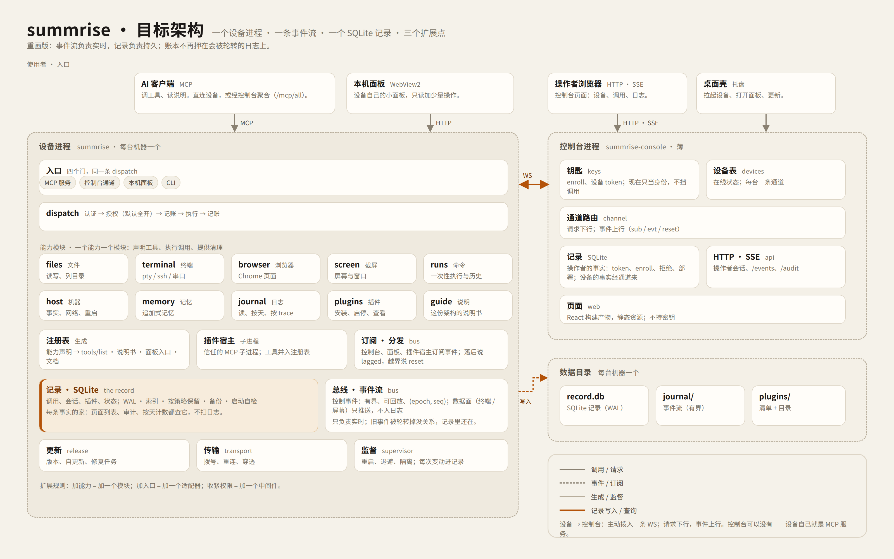

# Summrise v2: the architecture of record (proposal)

> **Status: proposal on `next`, 2026-11-13.** It supersedes the *storage model* of
> `architecture-of-record-2026-11-12.md` §4.4 and the "one journal" slogan of the first draft. Every
> other contract in that document stands unless restated here. This is the M0 deliverable: the design
> the v2 slices implement, with the parity matrix beside it (`v1-parity.md`).



## 0. What "best" means here

"Best" without a scoreboard is taste. These are the five criteria, ranked, and every decision below is
argued against them:

1. **The record does not lose facts.** A row that was written is not dropped by a rotation, a crash, an
   upgrade, or a reset. This is the product's third pillar ("record and brake"), so it outranks the rest.
2. **Adding a thing costs one place.** A tool, a wire field, a page view — one definition, everything
   else derived or generated.
3. **The loop is short.** One build, one test command per language, one release pipeline. A change that
   needs a two-minute build plus three suites to see is a change nobody makes on a whim.
4. **The operational surface is small.** Few processes, files and ports; one person at 2 a.m. can hold
   it in their head.
5. **A new maintainer can find things.** A behavior maps to a directory a stranger can guess.

The first draft failed criterion 1: it called the journal "the only record" while the journal is capped
at 64 MiB / 7 days. A record that can be rotated away is not a record. That sentence is withdrawn; the
decision that replaces it is D1.

## 1. Decisions

### D1 — Two jobs, two stores

**The contract is the architecture; the engine is not.** A record here must: append a unit of work in
one transaction; list and paginate by time, tool, token, device and status; aggregate a day; find a row
by trace; delete by a retention policy; back itself up and restore; check its own integrity at boot; and
refuse to be written by more than one process. Those requirements come from the product ("record and
brake"), not from a database vendor, and any engine that meets them is acceptable.

SQLite is the **default engine** because it meets them cheaply on Windows: transactions and WAL crash
recovery, indexes for the queries above, one file to copy for a backup (`VACUUM INTO`), `quick_check`,
no server to operate, bundled into the binary. It is not a load-bearing architectural choice: the
boundary rule is that **SQL lives only in the `store` module**, and every caller uses record operations
(`append_call`, `list_calls`, `day_counts`, `find_trace`, `prune`, `backup`, `check`). Replacing the
engine is replacing that module plus an export/import; no capability, entry or page changes.

The one thing the interface must not become is a generic CRUD layer. It names the product's questions;
when the questions change, the interface changes with them. That is cheaper than an abstraction built
to anticipate an engine swap that may never happen.

| | stream (`journal`) | record (default engine: SQLite) |
|---|---|---|
| what it is | append-only events, fsync, segmented | transactional tables, WAL, indexed |
| what it is for | live subscriptions, replay of recent events | the record: calls, sessions, plugins, tokens, deploys |
| retention | bounded (size and age) — **losing old events is fine** | policy retention (default 90 days for calls), explicit backups |
| failure | a torn tail is truncated; the record is untouched | WAL recovery; `quick_check` on boot; restore from backup |
| query | sequential, newest-first | SQL, any index |
| writer | the device, one | **exactly one process per database** |

**The invariant:** every fact has exactly one writer and one home. A fact is never re-derived by
guessing from another store. The stream is not a home; it is how a fact reaches a subscriber. The
console's database is the home of operator-side facts (who minted what, which token called, what the
console refused). The device's database is the home of machine-side facts (what ran, in which session,
with what outcome). A proxied call appears in both as two *perspectives* joined by `trace.call` — not as
two copies of one fact.

Why not JSON Lines: no transactions, no indexes, no integrity check, and a rotation that silently
drops the oldest rows — which is exactly the failure this design replaces. The engine is the cheap part;
the guarantees are the point.

### D1b — The bus stays, as the stream

Nothing about subscriptions is removed. The `journal` module keeps the whole event mechanism the
product already uses: `subscribe(from_seq)` with replay-then-live, the channel's `sub` / `evt` / `reset`
frames, `lagged` when a subscriber falls behind, terminal follow on a session's notifier, and the page's
SSE. The event names stay too: `call.started`, `call.finished` / `call.denied`, `session.opened` /
`closed`, the plugin lifecycle, state changes.

It also keeps the two delivery classes §4.1 defines: **control events** are journaled, ordered and
replayable; **data-plane** frames (terminal bytes, screen frames) are pushed to their subscriber on the
session's own notifier and never journaled, so a PTY flood cannot grow the record. One bus, two
delivery classes — the same rule as v1, not a new one.

What changes is its job. The stream is published **after** the record commits (an outbox, not a second
home). A subscriber that lags or is reset recovers by querying the record — not by replaying a stream
that retention may have shortened. That is what lets the stream be small; it is also why the console can
stop being the second writer of a call and become a reader of the device's perspective.

The crate is gone, the mechanism is not: `bus` becomes `device/src/journal`, owned by one process. It
stops being a general-purpose library the console also links, because there is now only one writer and
one reader shape.

### D2 — Every fact carries its identity

- Every row in either record has `trace` (a unit of work) and `ts_ms` (the clock of the process that
  wrote it).
- A row that mirrors a stream event also stores `(epoch, seq)`. An old row is then never confused with
  a row written after the journal was rebuilt — the epoch makes the position unambiguous.
- Nothing orders by `ts_ms`; ordering is `(epoch, seq)` or the database's own rowid.

### D3 — A capability is one module

```rust
pub trait Capability: Send + Sync {
    fn spec(&self) -> &'static CapabilitySpec;
    fn call(&self, tool: &str, args: &Args, cx: &CallCx<'_>) -> ToolOutcome;
    fn dispose(&self, cx: &CallCx<'_>) {}   // sessions, monitors, children
}

pub struct CapabilitySpec {
    pub name: &'static str,
    pub tools: &'static [ToolSpec],   // name, JSON schema, destructive *label*, guide section
    pub guide: &'static str,          // the manual entry, rendered from this spec
    pub panel: &'static [PanelEntry], // what the device's own panel shows
}
```

The registry is the union of the specs, built once at boot. `tools/list`, the guide, the panel, the
tool catalogue page, the docs and the conformance tests all read it. Adding a tool is one module and its
test; there is no second place to update.

### D4 — One dispatch, four doors, one chain

```
MCP (HTTP/stdio) ─┐
console channel  ─┼─▶ CallRequest { door, tool, args, caller, trace } ─▶ dispatch
local panel      ─┤        │
CLI              ─┘        ▼
                     identity → policy → record(start) → capability → record(end)
```

- An entry adapts its protocol to `CallRequest`; it never calls a capability directly.
- The chain is a list of middlewares. The policy middleware is **open by default** (the operator's
  decision on 2026-11-13: token is identity, not permission), but the seam exists and its refusal path
  is tested, so tightening later is a middleware, not a refactor.
- `record(start)` / `record(end)` are the only writers of a call row; a capability cannot write one.

### D5 — Contracts have one source

`crates/protocol` defines the wire types once: `Envelope`, the channel frame, the audit line, the
`journal.*` answers, the guide document, the panel snapshot. Rust derives JSON (de)serialization and
TypeScript types (`ts-rs`). A test writes `web/src/protocol.d.ts` and fails when it is stale; a second
test reads golden fixtures in `protocol/fixtures/` and asserts the same bytes on both sides. The page
never hand-writes a field the device sends.

### D6 — Supervision is a tree

- `summrise-launch` supervises the device process (it outlives it, so it can update it).
- The device supervises plugin child processes: backoff 1/2/4/8/16/30 s; five starts in 300 s marks a
  plugin `failed`; stopping kills the tree.
- Capabilities dispose what they own (terminals, monitors, browser pages) on unload and on shutdown.
- Every transition is a record row and a stream event. "It restarted at 03:14" is a fact, not a log line
  in a console nobody reads.

### D7 — Permissions are identity plus the record

The operator's decision of 2026-11-13: no scopes, no destructive consent. A token identifies the caller;
the record says what it did; the stop button and the machine are the brakes. The code keeps the policy
middleware (D4) so a future deployment can add a rule without touching a capability, and the UI keeps
the "destructive" label as advice.

## 2. The code

```
crates/
  protocol/     wire types, golden fixtures, generated TypeScript
  core/         registry, policy decision, sessions — pure, no I/O
  store/        SQLite: open, migrate, retention, backup, integrity
  device/       bin summrise-device
    journal/    the stream: segments, fsync, subscribe, replay
    entries/    mcp.rs, channel.rs, panel.rs, cli.rs
    dispatch/   middleware chain
    capabilities/ files.rs terminal.rs browser.rs screen.rs runs.rs host.rs memory.rs
                  journal.rs plugins.rs guide.rs forward.rs
    record/     the device's tables and queries
    supervisor/ plugins, restarts
    update/     signed release document, self-update, repair
  console/      bin summrise-console
    devices.rs  registry, presence
    channel.rs  one WebSocket per device, requests down, events up
    record/     operator tables + device perspectives
    http/       operator session, /mcp, /mcp/all, /audit, /journal/*, SSE
    page/       static assets (the React build), no keys
  ui/           design tokens shared by console and the device panel
  platform/     the Windows boundary (winsec + winsys merged)
  mesh/         NAT traversal / transport
  shell/        bin summrise-shell (tray, WebView2)
  launch/       bin summrise-launch (supervisor)
vendor/portable-pty
```

Ten crates, four binaries. What is gone, and why: `console-page` is a module of the console (the page
still holds no keys — the type that serves it has no accessor for them); `bus` is the device's `journal`
module (one owner, not a general-purpose library); `console-logic` (wasm) is deleted — generated
TypeScript and golden fixtures replace it; `release` is `device/update` plus a protocol type.

## 3. Failure modes

| Failure | What happens | Guarantee |
|---|---|---|
| device process dies | launcher restarts it; subscribers reconnect | committed record rows survive; the stream may lose ≤16 ms of unpublished tail |
| power loss | journal tail truncated to the last valid frame; SQLite WAL replays | no half-written row; a published event was fsynced |
| record corrupt | boot `quick_check` fails: the process serves read-only and says so | it never silently writes over a damaged record; restore from backup |
| stream corrupt | truncate the torn tail; the record is untouched | the record does not depend on the stream |
| retention | rows deleted by policy in batches; `VACUUM` occasionally | the record outlives the stream by design |
| upgrade | forward-only migrations in a transaction, after `VACUUM INTO` backup | an older build refuses a newer schema; rollback restores the backup |
| console down | device keeps serving; its panel works; its record grows | no fact depends on the console being up |
| device unreachable | console shows the last known and says "offline" | no fabricated rows, no silent gap |
| duplicate delivery | a retried call with the same `trace` records once | idempotent by `trace` |
| plugin crash loop | supervisor marks it failed, unregisters its tools | one row and one stream event say why |

## 4. Why this is better than the alternatives

- **v1 today.** Thirteen crates; a JSONL audit capped at 64 MiB that can silently drop old rows (the
  "record and brake" pillar's weakest point); the same wire field hand-copied across four layers (the
  epoch round touches ~20 sites); a page role as a separate crate for a boundary a module can hold.
  Measured: adding one field this week cost edits in the bus, the device tools, the frame, the console
  audit, the live event, the page types and two hooks.
- **"The journal is the only record."** The draft sentence. It loses on retention (the journal is
  capped), on reset (a rebuilt journal changes what a position means — that is why the epoch exists),
  and on queries (every view becomes a scan). Rejected; see D1.
- **Everything is a plugin (Cordis-style).** Elegant for a tool whose users replace every part; here it
  would make "which code wrote this row" a runtime question and add a composition language to a product
  whose install is a signed Windows binary. Not this product.
- **Microservices per capability.** Process tax, Windows service tax, and a network hop in the one path
  that must be fast.
- **Full event sourcing.** Replay cost for a benefit the record already gives; deferred, not forbidden.

## 5. Migration (the slices)

Each slice is one round on `next`, with tests, a parity check, and `hub/v1` untouched. A slice that
cannot be rolled back alone does not land.

| Slice | What lands | Acceptance |
|---|---|---|
| **S0** | this document + `v1-parity.md`; the v1 release runs through the pipeline | design reviewed; v1 installer built and installed on a machine |
| **S1** | `store` crate; console record from SQLite; import existing `events.jsonl` once; Activity reads the record | same Activity from the record; import idempotent; old file kept as archive |
| **S2** | device record; `journal.read/get/day` answered from it; the stream stays for live; the epoch from the parked branch | answers unchanged for a live journal; old rows survive stream retention; parity tests |
| **S3** | capability module + generated registry + guide from specs | a sample capability is one file; the guide lists every tool; removing it removes its tools |
| **S4** | entries + middleware; four doors on one dispatch | the conformance suite runs against every door; the policy middleware can be switched off |
| **S5** | `protocol` crate + generated TypeScript + golden fixtures; `console-logic` deleted | a wire change is one type plus generated output; both sides read the same fixtures |
| **S6** | crate merge (`console-page`, `ui`, `platform`, `release`), dead code removed; v2.0 | v2.0 released, deployed, rollback drilled; parity matrix green |

## 6. Review focus

- The record's own failure path: crash, corruption, migration, backup and restore — not just its happy
  path.
- The one-writer invariant, including the import (who may write which row).
- That the page reads the record, not a re-derivation of it.
- That adding a tool is one file, demonstrated rather than asserted.
- That no slice makes `hub/v1` unshippable.
